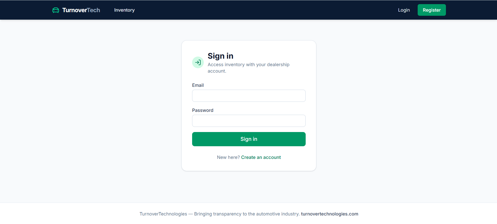
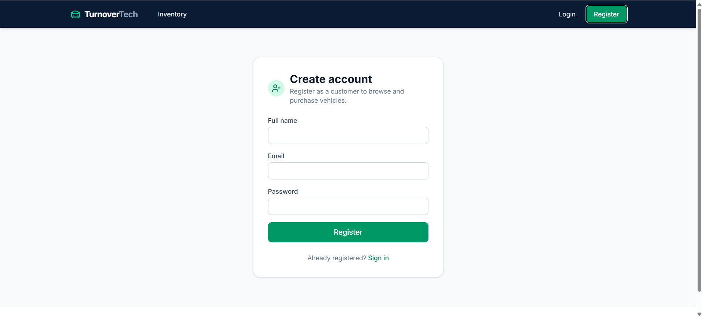
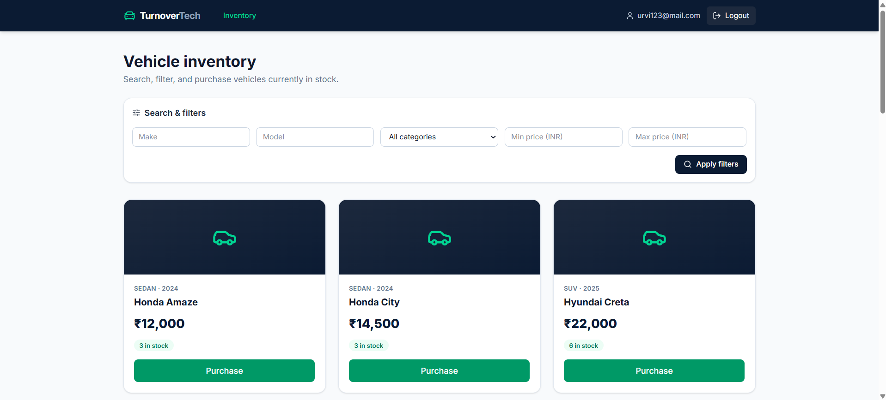
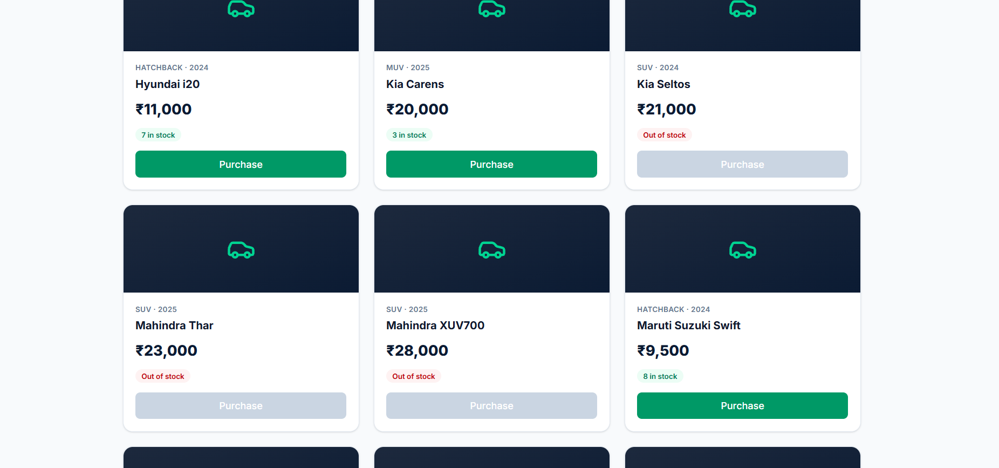
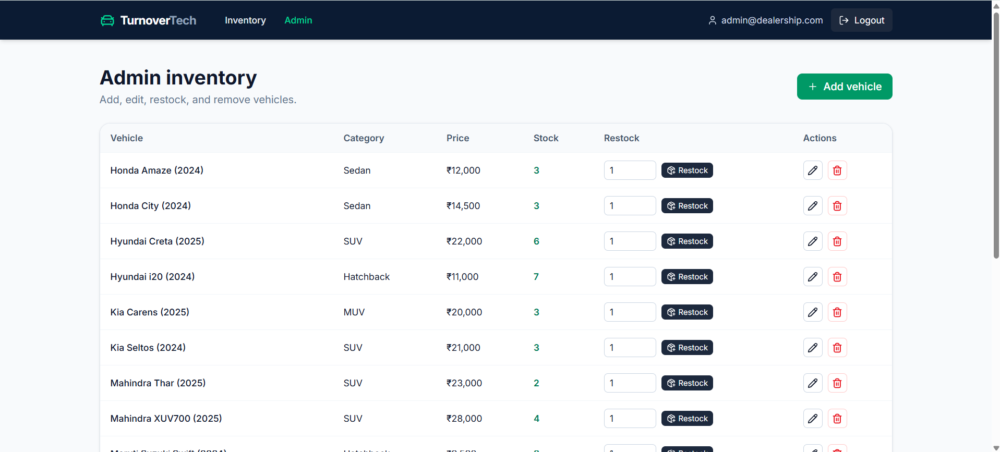

# Car Dealership Inventory System

A full-stack car dealership inventory management platform built with a TypeScript monorepo using Express, MongoDB (Mongoose), React (Vite), Tailwind CSS, and Vitest.

---

## Architecture & Technology Stack

- **Backend API:** Node.js, Express 5, TypeScript (ESM)
- **Database & ODM:** MongoDB, Mongoose
- **Validation:** Zod
- **Authentication:** JWT with bcrypt password hashing
- **Frontend:** React 19, Vite, React Router
- **Styling:** HTML5, CSS3, Tailwind CSS
- **Testing:** Vitest, Supertest, React Testing Library, MongoDB Memory Server

---

## Setup & Installation

**Prerequisites:** Node.js, npm, and a MongoDB Atlas or local MongoDB instance.

### 1. Install dependencies

```bash
git clone https://github.com/urushanos/car-dealership-inventory
cd car-dealership-inventory
npm install
```

### 2. Configure environment variables

Create `apps/api/.env` with the variables expected by the backend configuration:

```env
PORT=BACKEND_PORT
MONGODB_URI=MONGODB_CONNECTION_STRING
JWT_SECRET=SECURE_RANDOM_SECRET
```

Create `apps/web/.env` if required by the frontend:

```env
VITE_API_BASE_URL=http://localhost:5000
```

### 3. Run the application

Start both applications from the repository root:

```bash
npm run dev
```

- **Frontend:**`http://localhost:3000`
- **Backend API:** `http://localhost:5000`

### 4. Build for production

```bash
npm run build
```

---

## Authorization Policies

All vehicle endpoints require a valid JWT Bearer token. Registration and login are public.

| Method   | Endpoint                     | Access Level | Description                     |
| -------- | ---------------------------- | ------------ | ------------------------------- |
| `POST`   | `/api/auth/register`         | Public       | Register a user                 |
| `POST`   | `/api/auth/login`            | Public       | Authenticate and obtain a token |
| `GET`    | `/api/vehicles`              | User & Admin | List vehicles                   |
| `GET`    | `/api/vehicles/search`       | User & Admin | Search and filter vehicles      |
| `GET`    | `/api/vehicles/:id`          | User & Admin | Retrieve vehicle details        |
| `POST`   | `/api/vehicles`              | Admin only   | Add a vehicle                   |
| `PUT`    | `/api/vehicles/:id`          | Admin only   | Update vehicle details          |
| `DELETE` | `/api/vehicles/:id`          | Admin only   | Delete a vehicle                |
| `POST`   | `/api/vehicles/:id/purchase` | User & Admin | Purchase one vehicle            |
| `POST`   | `/api/vehicles/:id/restock`  | Admin only   | Increase stock quantity         |

**Design decision:** Creation, editing, and restocking are also restricted to administrators to prevent ordinary users from modifying inventory, prices, or stock quantities.

Protected requests must include:

```http
Authorization: Bearer JWT_TOKEN
```

---

## Vehicle API Specification

### 1. Listing Vehicles

- **Endpoint:** `GET /api/vehicles`
- **Headers:** `Authorization: Bearer <token>`
- **Response:** `200 OK` on success.

### 2. Searching Vehicles

- **Endpoint:** `GET /api/vehicles/search`
- **Headers:** `Authorization: Bearer <token>`
- **Query parameters:**

| Parameter  | Type   | Validation                                                |
| ---------- | ------ | --------------------------------------------------------- |
| `make`     | String | Case-insensitive substring match                          |
| `model`    | String | Case-insensitive substring match                          |
| `category` | String | Case-insensitive substring match                          |
| `minPrice` | Number | Non-negative, inclusive lower bound                       |
| `maxPrice` | Number | Non-negative, inclusive upper bound; must be ≥ `minPrice` |

Text search inputs are escaped to prevent regular-expression injection.

Examples:

```http
GET /api/vehicles/search?make=Toyota
GET /api/vehicles/search?model=Corolla
GET /api/vehicles/search?category=SUV
GET /api/vehicles/search?minPrice=20000&maxPrice=35000
GET /api/vehicles/search?make=Toyota&category=Sedan
```

### 3. Creating a Vehicle

- **Endpoint:** `POST /api/vehicles`
- **Access:** Admin only
- **Body:**

```json
{
  "make": "Toyota",
  "model": "RAV4",
  "category": "SUV",
  "price": 32000,
  "quantity": 3,
  "year": 2024,
  "vin": "JTMDFRFV6RD000002",
  "status": "available"
}
```

- `make`, `model`, and `category` must be non-empty trimmed strings.
- `price` must be a non-negative number.
- `quantity` must be a non-negative integer.
- `year` must be an integer ≥ 1900.
- `vin` is optional if automatic VIN generation is enabled.
- Duplicate VINs return `409 Conflict`.

### 4. Updating a Vehicle

- **Endpoint:** `PUT /api/vehicles/:id`
- **Access:** Admin only
- Invalid MongoDB ObjectIds return `400 Bad Request`.
- Missing vehicles return `404 Not Found`.
- Negative prices and invalid quantities are rejected with `400 Bad Request`.

### 5. Deleting a Vehicle

- **Endpoint:** `DELETE /api/vehicles/:id`
- **Access:** Admin only
- Regular users receive `403 Forbidden`.
- Invalid IDs return `400 Bad Request`.
- Missing vehicles return `404 Not Found`.
- Successful deletion returns `200 OK`.

### 6. Purchasing a Vehicle

- **Endpoint:** `POST /api/vehicles/:id/purchase`
- **Access:** User or Admin
- Atomically decrements `quantity` by one only when stock is greater than zero.
- Returns `200 OK` on success.
- Returns `409 Conflict` when the vehicle is out of stock.
- Returns `404 Not Found` for a missing vehicle.
- Returns `400 Bad Request` for an invalid vehicle ID.

### 7. Restocking a Vehicle

- **Endpoint:** `POST /api/vehicles/:id/restock`
- **Access:** Admin only
- **Body:**

```json
{
  "quantity": 5
}
```

- Rejects regular users with `403 Forbidden`.
- Accepts the configured positive-integer restock field.
- Rejects zero, negative, and fractional quantities.
- Uses an atomic increment to increase stock.
- Returns `404 Not Found` for a missing vehicle and `400 Bad Request` for an invalid ID.

---

## Frontend Application

The React single-page application provides:

- Registration and login forms.
- Vehicle inventory dashboard.
- Search and filtering by vehicle attributes and price.
- Vehicle cards with purchase functionality.
- Purchase button disabled when stock is zero.
- Admin forms to add, update, and delete vehicles.
- Responsive styling using Tailwind CSS.

---

## Running Tests

Run all backend and frontend tests from the repository root:

```bash
npm test
```

Run individual suites:

```bash
npm test --workspace=apps/api
npm test --workspace=apps/web
```

### Backend Test Files

Run using `npm test` from `apps/api`.

| Test file                        | Coverage                                                                      |
| -------------------------------- | ----------------------------------------------------------------------------- |
| `app.test.ts`                    | Application setup, database connectivity, and model validation                |
| `tests/auth.test.ts`             | Registration, login, password hashing, JWT verification, and admin seeding    |
| `tests/vehicles.test.ts`         | Vehicle CRUD, search filters, authorization, and edge cases                   |
| `tests/purchase-restock.test.ts` | Purchase/restock, atomic updates, concurrency safeguards, and role protection |

### Frontend Test Files

Run using `npm test` from `apps/web`.

| Test file                          | Coverage                                 |
| ---------------------------------- | ---------------------------------------- |
| `src/test/ConfirmDialog.test.tsx`  | Confirmation dialog behavior             |
| `src/test/Login.test.tsx`          | Login form behavior                      |
| `src/test/ProtectedRoute.test.tsx` | Protected route access                   |
| `src/test/VehicleCard.test.tsx`    | Vehicle display and purchase actions     |
| `src/test/VehicleFilters.test.tsx` | Search and filtering                     |
| `src/test/VehicleForm.test.tsx`    | Vehicle form validation and interactions |
| `src/test/api.test.ts`             | API client behavior                      |
| `src/test/register.test.tsx`       | Registration form behavior               |

### Test Report

- **Execution date:** 25-10-2026
- **Backend:** 67 passed (67)
- **Frontend:** 59 passed (59)
- **Total:** 12 Test Files, 126 passed (126)

**Test report files:** test-reports/ (test-reports folder in project root)

The project follows a Test-Driven Development approach: Red (failing test), Green (implementation), and Refactor. The Git history should demonstrate this workflow.

---

## Screenshots

| Screen | Screenshot |
| :--- | :--- |
| Login |  |
| Registration |  |
| Vehicle Dashboard and Filters |  |
| Purchase / zero-stock state |  |
| Admin inventory management |  |

---

## My AI Usage

### Tools Used

AI Tools Used : ChatGPT and Gemini

### How AI Was Used

I utilized AI assistance as a collaborative partner throughout the lifecycle of this project, focusing on the following areas:

- **Architecture & Planning:** Brainstormed the initial project structure, database schemas, and folder layout to ensure scalability.
- **Testing & Implementation:** Translated natural language requirements into robust automated test cases and assisted with core logic implementation.
- **Debugging & Documentation:** Accelerated troubleshooting for runtime errors and streamlined the generation of code documentation.

### Reflection

Integrating AI into my development workflow significantly accelerated my delivery speed and served as an excellent educational tool. 

- **Accelerated Workflow:** The AI instantly handled repetitive boilerplate setup, which dramatically sped up overall project construction.
- **Architecture & Testing:** It provided solid structural recommendations that kept the project clean and helped me refine my test suites from basic checks into comprehensive edge-case coverages.
- **Deep Learning Curve:** By reviewing, debugging, and verifying the AI's output, I gained a much deeper understanding of React architecture, state management and component lifecycles. 

While the AI offered exceptional baseline code, human verification was essential to catch minor edge cases, ensuring the final application remained stable and fully aligned with the project's core requirements.

---

## Project Links & Deliverables

- **Public repository:** [https://github.com/urushanos/car-dealership-inventory](https://github.com/urushanos/car-dealership-inventory)
- **Test report:** `test-reports/`
- **Screenshots:** `screenshots/`
- **AI conversation logs:** Maintained separately in the required root-level `PROMPTS.md`.
